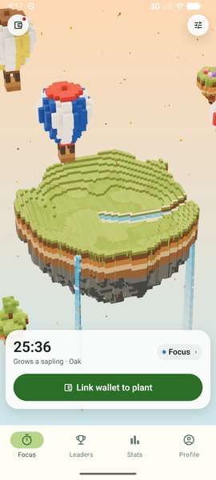
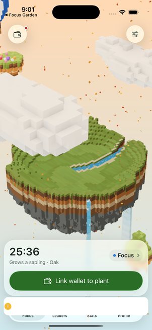

# Focus Garden Next

A separate Expo rebuild of [Crypto Focus Garden](https://github.com/salemkode/crypto-focus-garden), Salem's original hackathon project. Focus sessions grow a local 3D valley; the native apps also contain the existing Chipnet wallet and verified-reward integration.

**Review candidate, not a production deployment.** The fork preserves the current hybrid-credit policy. Live chain acceptance, browser transaction signing, store distribution and mainnet approval are outstanding. See [verification and limits](docs/VERIFICATION.md).

## Starting point and rebuilt app

- `main` preserves original commit `de708cdfdce688e2b41465861ab6e011e26d97a3`.
- `feat/expo-rebuild` contains this application and the current contracts.
- [Compare the starting point and rebuilt app](https://github.com/salemkode/focus-garden-next/compare/main...feat/expo-rebuild).
- The full original Git history is retained. [Provenance](docs/FORK-PROVENANCE.json) also identifies the later, uncommitted development source used for the migration.
- GitHub returned the existing repository when asked for another fork in the same account. This is a separate repository with preserved ancestry and an `upstream` remote; it does not have a second native GitHub fork badge.

The original local application remains separate. This app uses bundle/package ID `com.arquebus.focusgarden.next`, URL scheme `focusgardennext`, a separate storage sandbox and Metro port **8183**.

| Android | iOS |
| --- | --- |
|  |  |

These are recorded checkpoints. See the verification report for the tested scope and outstanding release work.

## Run

Use Bun 1.4.4 or compatible, Node 22+, and the platform SDKs for native builds. This is an Expo SDK 58 / React Native 0.88 development-build app; its custom native modules require a native build rather than Expo Go.

```sh
bun install --frozen-lockfile
bun run web
```

For native development, select an available owned simulator/emulator, then run `bun run ios` or `bun run android`. Xcode and CocoaPods are required for iOS; Android SDK, NDK and JDK are required for Android. `bun run start` reuses an installed compatible development build. Native projects are generated by Expo and ignored by Git.

No service configuration is needed for local sessions. Copy `.env.example` only when configuring optional integrations; it contains no credentials. Read [configuration](docs/CONFIGURATION.md) before enabling verified transactions or app blocking.

## Source layout

| Location | Responsibility |
| --- | --- |
| `src/app` | Expo Router screens and composition; one app for iOS, Android and web |
| `src/features` | Focus, valley history, rewards, wallet linking, recovery, profile and blocking |
| `src/components/valley` | Native Filament and web three.js rendering adapters; no wallet/service imports |
| `src/ui` | Shared design tokens and platform UI; native bottom tabs retained |
| `packages/garden` | Deterministic geometry, layout, merge planning and pure local progression |
| `packages/protocol` | Validated wire formats, on-chain rules and transaction policy |
| `packages/contracts` | Current CashScript source, deterministic artifacts and adversarial tests |
| `packages/service` | Existing bounded hybrid-credit service and durable operation ledger |
| `modules`, `plugins`, `targets` | Source-only native crypto/blocking integrations and Expo configuration |

[Architecture and reading order](docs/ARCHITECTURE.md) explains the boundaries and compatibility code. [Migration map](docs/MIGRATION.md) identifies what moved, what changed and what remains to be decided.

## Verify

```sh
bun run check
bun run export
bun run test:native-core
```

`check` runs application and service type checks, lint, generated-valley freshness, and app, geometry, service and contract tests. `export` produces all three platform bundles. `test:native-core` compiles the C crypto harness and compares it with libauth WASM. Native compilation and device acceptance are separate checks; exact results and recordings are documented in [VERIFICATION.md](docs/VERIFICATION.md).

For contracts, read [FocusForest.cash](packages/contracts/contracts/FocusForest.cash) and [FocusDirectory.cash](packages/contracts/contracts/FocusDirectory.cash) first. Run `bun run contracts:compile` to regenerate the checked-in artifacts. Compiling does not deploy or create a token category.

MIT licensed. Retained upstream/vendor notices remain with their source.
