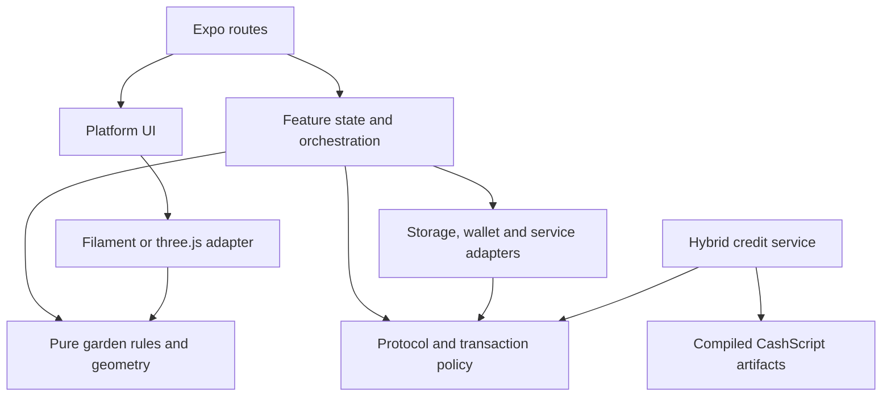

# Architecture and review guide

The repository contains one Expo app and four focused workspaces. The root follows the standard Expo project shape; the empty template is recorded in `EXPO-TEMPLATE.json`. Tested product code was migrated selectively from the later development workspace. It was not all rewritten: wallet recovery, signed-operation recovery and native rendering contain substantial compatibility code that deserves review before release.

## Read in this order

1. `src/app/_layout.tsx` and `(tabs)/_layout.tsx`: providers, route ownership and retained native bottom tabs.
2. `src/features/focus/session.ts` and `FocusProvider.tsx`: local session state, completion/withering and persistence.
3. `packages/garden/src/rules.ts`, `merge-plan.ts`, `engine/valley-scene.ts`: pure progression, deterministic merges and scene geometry.
4. `src/components/valley/ValleyView.tsx`, `controller.ts`, `ValleyHost.native.tsx` and `.web.tsx`: interaction and renderer boundaries.
5. `packages/protocol/src/rules.ts`, `forest.ts`, `policy.ts`, `signing.ts`: on-chain format, tier constraints and local transaction validation.
6. `packages/contracts/contracts/FocusForest.cash`, then `FocusDirectory.cash` and `test/contract/FocusForest.test.ts`: covenant and adversarial examples.
7. `src/features/rewards/RewardProvider.tsx`, `src/services/transactions.ts` and `src/features/rewards/signer.ts`: native transaction orchestration and recovery.
8. `packages/service/src/api.ts`, `ledger.ts`, `transactions.ts` and `chain.ts`: service authority, persistent idempotency, construction and chain observations.

Use `bun run check` while reviewing. Architecture tests enforce that valley adapters do not import wallet/reward/service code and that protocol source stays independent of the native app. These checks cover direct imports, not a complete static dependency graph or a security audit.

## Dependency direction

Rendering consumes scene/item data and emits interaction events. It cannot sign, fund or broadcast. `src/features/three` and `ModelSnapshots` still provide model previews; this fork does not replace them with pre-rendered assets or establish a new performance baseline.

## Local progression and contract rewards are different systems

The local valley has ten levels and a one-hour session cap. Its progression is in `garden/rules`, with no crypto, native API or renderer initialization required. Layout and merges are deterministic, based on recorded items and seeds.

FocusForest v5 uses **four** on-chain tiers and six species. Its lock unit is **512 seconds**, maximum 24 units. Minimum tiers use 1, 3, 6 and 11 units. Contract merges require 3 Sprouts → Tree, 2 Trees → Big Tree, 2 Big Trees → House. `protocol/rules` owns these constants; app presets derive their durations from them. Local “Seedling” labels are not proof of a token, maturity or ownership. The app's one-hour local session selector also does not expose every possible contract duration.

A completed local timer proves only an app event. A verified reward requires valid contract state, the configured chain identity and confirmation policy. Wall-clock completion cannot bypass relative transaction maturity.

## Wallet and service responsibilities

An external wallet/reward address is separate from the app's helper wallet. Manual address entry selects a recipient; it does not prove ownership. WalletConnect/WizardConnect linking remains available, but third-party wallet round trips were not accepted end to end in this fork pass.

Native helper keys remain in SecureStore. The current mnemonic/XO implementation and early single-key recovery remain compatible. Recovery refuses to replace missing or mismatched vault material. A fresh app ID gives this fork a separate sandbox; users must explicitly restore rather than assume data or balances migrated.

The service retains the existing bounded treasury/credit model. The client checks prepared transactions locally before signing. It persists the idempotency key, intent and signed transaction before submission; an ambiguous response is reconciled, not replaced with a newly signed request. Chain authority is pinned to a validated node's genesis/checkpoint and confirmation requirements. Public Electrum is not an authority fallback. This architecture preserves current behavior; it does not implement the proposed move to user-funded top-ups.

## Platform boundaries

| Capability | iOS | Android | Web |
| --- | --- | --- | --- |
| Local focus, valley, stats and public recipient | Implemented | Implemented | Implemented |
| Native helper wallet, secure backup/recovery, credit transactions | Implemented; live acceptance pending | Implemented; live acceptance pending | Unavailable; no private helper seed created |
| App blocking | Optional Family Controls build and entitlement | Native permission/setup flow | Unavailable |
| Renderer | Filament, with webview fallback | Filament, with webview fallback | three.js |
| UI | SwiftUI form adapters and native tabs | React Native screens and native tabs | Shared React Native web screens and Expo tabs fallback |

`bootstrap.ts` initializes native crypto before synchronous root registration. `bootstrap.web.ts` waits for libauth WASM before loading Router. The static `require` is intentional: a dynamic import broke root registration/native startup and the browser's initial Metro module graph.

Web storage holds local sessions, preferences and public addresses. Reads tolerate server-side execution; unavailable writes fail explicitly. The web reward provider declares transactions unavailable. Native helper setup/recovery/access-key controls are hidden there; direct native recovery routes also fail without creating a key. This is a capability limit, not full verified-reward parity.

Android headerless tab screens apply the top safe-area inset once. Pushed screens rely on the navigation header. iOS SwiftUI forms manage their own safe area. The fork avoids removing shared padding to fix only one platform.

## Remaining release decisions

Choose and review the financial model, browser signing path, chain/network and deployment ownership before exposing real funds. Native blocking distribution needs platform entitlements/permissions and hardware acceptance. Release-mode Android R8, iOS distribution, offline/interrupt/recovery and real wallet transaction scenarios need a dedicated release pass. The native integrations and large wallet/reward orchestrators are retained review areas rather than evidence that every historical concern is solved.
